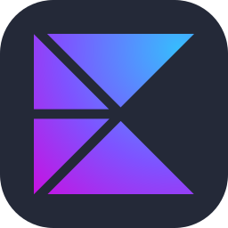

## Hey there 👋, I'm Nikita Obrekht

Android Developer · Kaliningrad

I build Android apps with Kotlin and Jetpack Compose. Currently exploring Kotlin Multiplatform and AI agents: MCP, RAG, local LLMs.

### Languages and Tools

Coroutines / Flow · Ktor · Room · LLM · MCP · RAG

